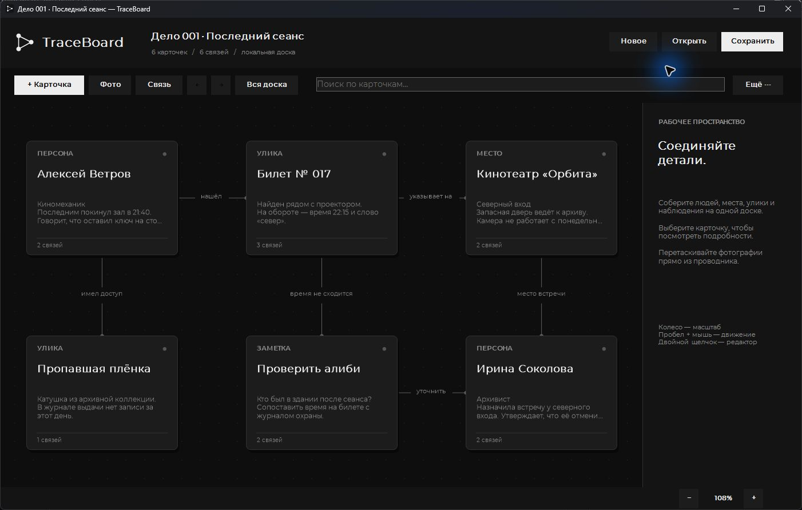
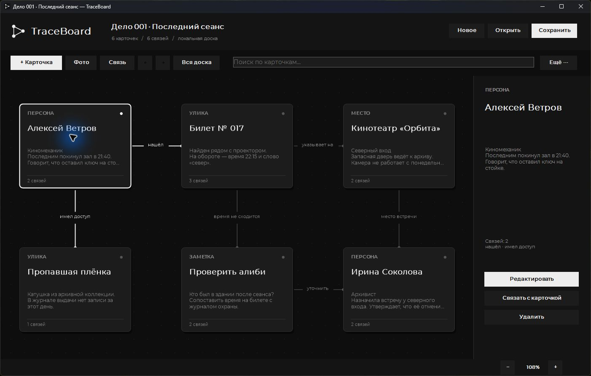

# TraceBoard

**Доска расследований: собирайте людей, улики, места и заметки в одну картину.**

Windows x64 · C# · .NET 8 · Windows Forms · Montserrat

Размещайте карточки на свободной доске, соединяйте их связями и подписывайте
отношения между деталями. TraceBoard подходит для сюжетов, исследовательских заметок
и разбора запутанных событий. Дела сохраняются локально в переносимый файл.



## Возможности

- **Четыре типа карточек** — персона, улика, место и заметка.
- **Описание и фото** — подробности каждой карточки доступны в боковой панели.
- **Связи с подписями** — фиксируйте отношения и противоречия между деталями.
- **Свободная доска** — перетаскивание, панорамирование и масштабирование.
- **Поиск и история действий** — находите нужное, отменяйте и повторяйте изменения.
- **Переносимые дела** — JSON-файл `.traceboard` включает карточки, связи и фотографии.
- **PNG-экспорт и черновик** — сохраняйте изображение доски и восстанавливайте работу.

## Детали карточки



На скриншотах — встроенное учебное дело «Последний сеанс».
Персонажи и события вымышлены. Снимки сделаны в работающем Windows-приложении.

## Собрать и запустить

Нужны **Windows** и **.NET 8 SDK**. В PowerShell:

```powershell
git clone https://github.com/reallynigeuteg7-ux/TraceBoard.git
cd TraceBoard
dotnet publish TraceBoard.csproj -c Release -r win-x64 --self-contained true -o ..\TraceBoard-Windows
..\TraceBoard-Windows\TraceBoard.exe
```

Собранная версия включает .NET Runtime. Для переноса скопируйте
**всю папку `TraceBoard-Windows`**, включая `Assets` и библиотеки.
Автоматическая сборка также доступна через [build.ps1](build.ps1).

## Собрать своё дело

1. Нажмите **Новое**, затем **+ Карточка** и выберите тип.
2. Заполните название, описание и при необходимости добавьте фото.
3. Расположите карточки на доске; нажмите **Связь** и выберите две карточки.
4. Двойным щелчком по связи задайте подпись. Сохраните дело через **Ctrl+S**.

| Действие | Управление |
| --- | --- |
| Редактировать карточку / связь | Двойной щелчок |
| Переместить карточку | Перетаскивание левой кнопкой |
| Переместить доску | Пустой фон, средняя кнопка или Пробел + мышь |
| Масштабировать | Колесо мыши или − / + |
| Показать всю доску | F |
| Отменить / повторить | Ctrl+Z / Ctrl+Y |
| Экспортировать PNG | **Ещё → Экспорт PNG** |

## Как устроен проект

| Файл | Назначение |
| --- | --- |
| [BoardCanvas.cs](BoardCanvas.cs) | Отрисовка, связи, навигация и экспорт |
| [MainForm.cs](MainForm.cs) | Главное окно, команды и файловые операции |
| [Models.cs](Models.cs) | Формат дела, проверка данных и история |
| [Dialogs.cs](Dialogs.cs) | Редакторы и импорт фотографий |
| [Theme.cs](Theme.cs) | Монохромная тема и подключение Montserrat |

До 500 карточек и 2000 связей; размер открываемого дела — до 100 МБ.
Черновик находится в `Data/Recovery.traceboard` рядом с exe.
Папке программы нужен доступ на запись. Несколько экземпляров из одной папки
используют общий черновик.

**Документация:** [полное управление, форматы и ограничения](docs/GUIDE.md) ·
[лицензия Montserrat](Assets/Fonts/OFL.txt).
